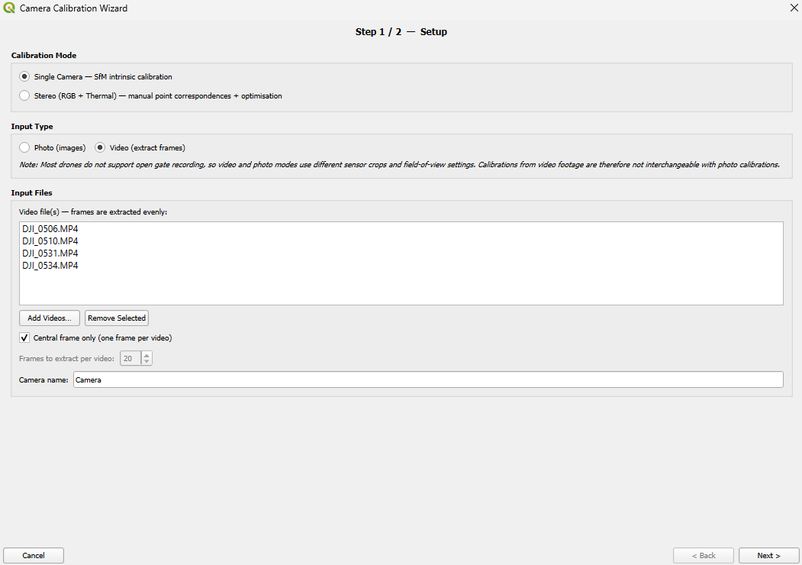
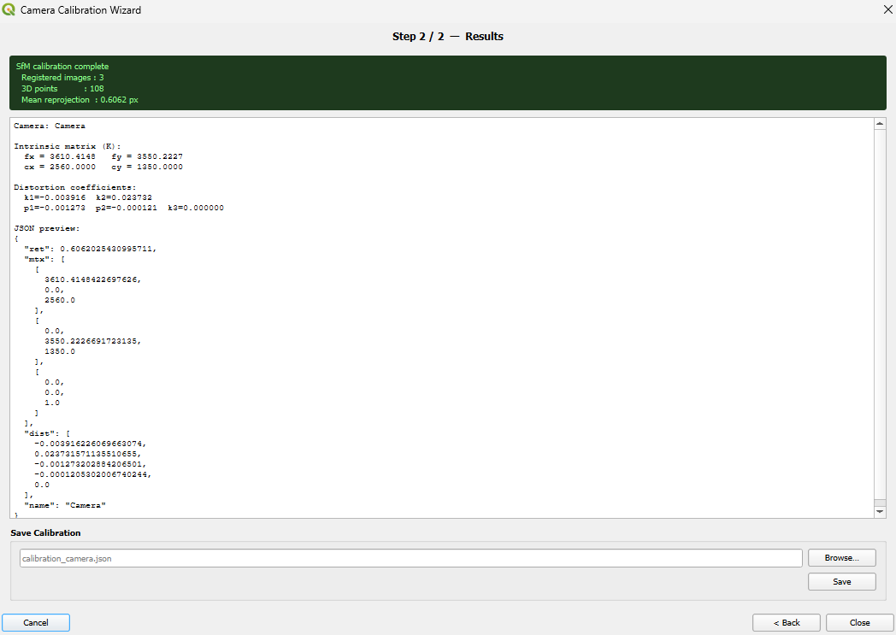
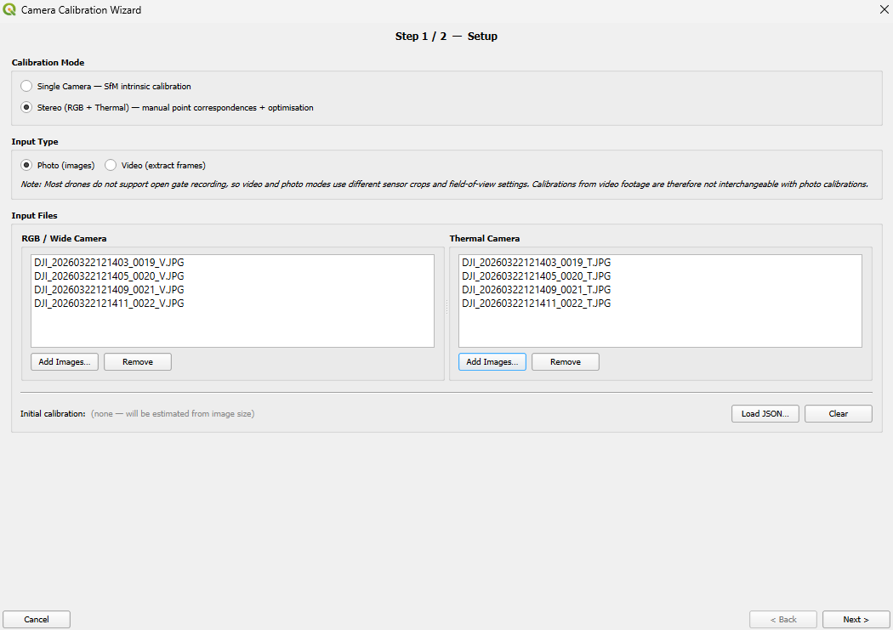
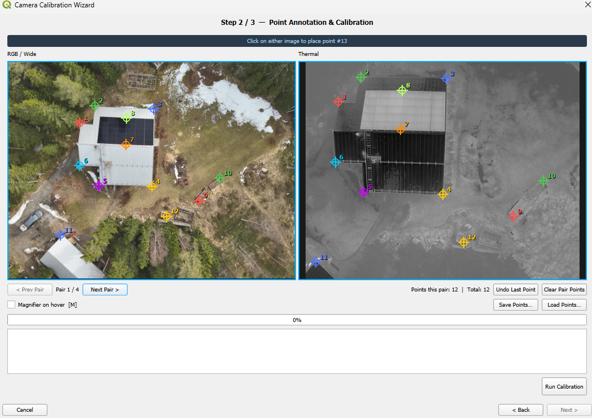
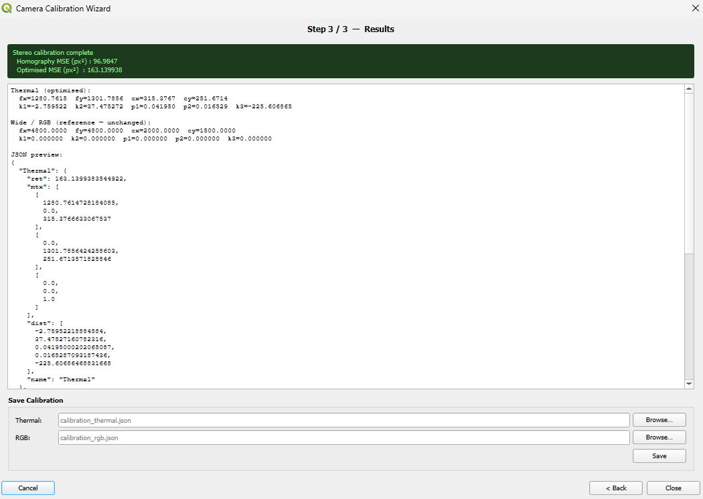

# Camera Calibration Wizard

Cameras show distortions due to their lenses, so image positions can't be mapped accurately without correction. The Camera Calibration Wizard estimates intrinsic camera parameters (focal length, principal point, distortion coefficients) and exports them as calibration JSON files that can be used directly as input for the [main processing pipeline](pipeline.md). It is opened via the dedicated toolbar button next to the Correction Wizard.

## Recording calibration data

- **Video and photo calibrations are not interchangeable.** Most drones do not support open gate recording, so video and photo modes use different sensor crops and field-of-view settings. Always calibrate with the same input type you plan to use for processing.
- For video-based calibration we recommend creating multiple short recordings (~1 s) showing a reference object from multiple perspectives.
- When using auto-focus mode, the drone may adapt the lens setup. Try to keep the calibration setup comparable to your mission setup (e.g. distance from camera to object of interest).
- For **stereo calibration**, the recorded data should contain clearly distinguishable structures that are visible in both RGB and thermal imagery and appear at least once everywhere in the image space (all four corners and the center), to ensure robust calibration over the full field of view. Buildings have proven particularly suitable, especially roofs with sharp edges or solar panels, which provide both geometric detail and strong thermal contrast. Facades with windows also work, although maintaining a consistent distance is more challenging in side views.

## Single camera (Structure from Motion)

Uses pycolmap's incremental SfM pipeline to recover intrinsic parameters from a set of overlapping images or video frames of a static scene.

> **Requires pycolmap**: install it via the [Dependency Manager](installation.md#dependency-manager). Not needed for stereo calibration.



**Input options:**

| Option | Description |
|--------|-------------|
| Photo (images) | Add one or more still images showing the scene from multiple angles |
| Video (extract frames) | Add one or more video files; frames are extracted automatically before SfM |

When video input is selected, two extraction strategies are available:

- **Every N frames**: extracts a configurable number of evenly-spaced frames per video (default: 20). A progress bar is shown during extraction.
- **Central frame only**: extracts a single frame from the centre of each video. Useful when you have many short clips and want one representative frame per clip.

**Output:** One JSON file per camera:
```json
{
    "ret": 0.412,
    "mtx": [[fx, 0, cx], [0, fy, cy], [0, 0, 1]],
    "dist": [k1, k2, p1, p2, k3],
    "name": "Camera"
}
```



## Stereo (RGB + thermal)

Calibrates a paired RGB and thermal camera system by optimising the thermal camera's intrinsics so that manually annotated corresponding points reproject correctly into RGB space. The RGB camera is treated as the fixed reference and is not modified.

> **Recommended workflow**: Run a single-camera calibration for the RGB camera first, then apply the stereo calibration using the undistorted RGB frames to spatially align the thermal frames.

**Algorithm:**
1. An initial homography (RANSAC, 15 px threshold) maps thermal points into RGB space
2. Nelder-Mead optimisation (10 × 50 000 iterations) refines the thermal intrinsics (fx, fy, cx, cy, and 5 distortion coefficients) by minimising the mean-squared reprojection error
3. The fit is repeated with a part of the point pairs left out, and the points left out are used to check it (see [How good is the result?](#how-good-is-the-result))



**Input options:**

| Option | Description |
|--------|-------------|
| Photo (images) | Select one or more RGB images and the matching thermal images |
| Video (extract frames) | Select one RGB video and one thermal video; the central frame of each is extracted automatically |

### Annotating corresponding points

After input is configured, the annotation page shows the RGB and thermal frames side by side. Click on the same identifiable feature (e.g. a road marking, building corner, or any fixed object) in both images to place a point pair.

- Either image can be clicked first to start a point pair; the other image then becomes active to complete it
- Enable the **Magnifier** (checkbox or press `M`) to show a circular loupe under the cursor for sub-pixel precision
- Use **Save Points…** / **Load Points…** to persist and reload annotation work between sessions

**How many points, and where.** Nine numbers are fitted for the thermal camera, and a point pair gives two equations. At least **6 pairs** are needed to run the calibration; **12 or more** are recommended, and the counter under the images says so until they are placed. Where they are matters as much as how many: lens distortion shows towards the edges of the frame, so place points in all four corners, along the edges and in the centre. Points in one part of the frame calibrate that part and leave the rest a guess.

**With calibrations loaded.** If a calibration is loaded for a camera, its frames are shown *undistorted* with it, which makes features easier to pick. The thermal calibration that is saved is nevertheless the calibration of the thermal camera's **raw** frames - the loaded one refined, with the camera's whole distortion. (Up to 9.0 only the distortion left over after the loaded calibration was saved, as if it were all there is; such a file undistorts raw thermal frames by a fraction of what they need. If you ran a stereo calibration on top of a loaded thermal calibration with 9.0 or earlier, run it again.)



**Output:** Two separate JSON files (one per camera):

*Thermal:*
```json
{
    "ret": null,
    "mtx": [[fx, 0, cx], [0, fy, cy], [0, 0, 1]],
    "dist": [k1, k2, p1, p2, k3],
    "name": "Thermal"
}
```

*RGB / Wide:*
```json
{
    "ret": null,
    "mtx": [[fx, 0, cx], [0, fy, cy], [0, 0, 1]],
    "dist": [k1, k2, p1, p2, k3],
    "name": "Wide"
}
```



### How good is the result?

The results page shows, next to the two calibrations:

| Line | Meaning |
|------|---------|
| Point pairs | How many pairs the fit was made from |
| Fit, its own points (RMS) | How far, in RGB pixels, the thermal points end up from their RGB partners with the fitted calibration. Small is necessary, but says little by itself: nine numbers bend to go through a handful of points whatever the camera is |
| Fit, points left out (RMS) | The same, for points the fit has **not** seen: the calibration is fitted three or four more times, each time without a third or a quarter of the pairs, and those are measured. This is the number to go by. It needs at least 9 pairs; with fewer the line reads *not checked* |

The box turns from green to amber, and says why, when the calibration should not be relied on as it is:

- **fewer than 12 point pairs**;
- the points span **less than half of the frame's width or height**;
- points left out of the fit are off by **more than three times** the error of the fit (and more than 3 px): the calibration holds for its own points only;
- the fit arrived at numbers no lens has: a distortion `k1` beyond ±1, an optical centre outside the frame, or a focal length more than 30 % away from the one it started from (only when that came from a loaded calibration or a field of view, not from the frame size alone).

The calibration can still be saved - the warnings are a judgement, not an error. The remedy is always the same: go back, place more points, spread over the whole frame, and run it again.

> Up to 9.0 four point pairs were enough to run the calibration, and nothing was said about the result. Four pairs are eight equations for nine numbers: with a pixel of imprecision in placing them the fit showed an error below one pixel while points elsewhere in the frame were off by 15 to 30. A stereo calibration made from fewer than about 10 pairs is worth running again.
