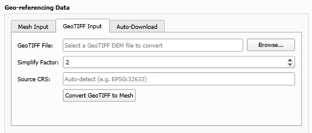

# DEM Import & Conversion

The processing pipeline needs a Digital Elevation Model as a GLB/GLTF mesh with a companion metadata JSON (see [DEM metadata JSON](pipeline.md#dem-metadata-json)). The plugin supports five ways to provide one, available as tabs in the **Input** section of the dock widget.

| Where the flight is | What to use |
|---------------------|-------------|
| Austria | **Download DEM (Austria)** - the national 1 m terrain model |
| Anywhere a terrain model can be had as a file (national LiDAR, a survey of your own) | **Convert a GeoTIFF DEM** |
| Anywhere else on land | **Download DEM (worldwide)** - the bare ground at 15 m from Google's GEM-15 where it has the flight, else the Copernicus surface model at 30 m |
| Over water | **Flat surface** |

## 1. Automatic download (Austria only)

Use the **Download DEM (Austria)** option to download and tile Austrian elevation data from the BEV ATOM service automatically. The tiles are large (50 km a side) and are kept in a cache, so a second flight in the same region downloads nothing; from them only the flight's own area (plus the padding) is read, also where a flight crosses the edge between two tiles (up to 9.0 that case merged both tiles whole, which took some 20 GB of memory and as much disk space).

**Interrupted downloads.** A tile is several hundred megabytes to gigabytes. It comes in under `<tile>.tif.part` in the cache (`~/.cache/austria_dem`) and gets its name only when it is as long as the server announced and a GeoTIFF whose contents all lie within the file. A connection that breaks is tried again from where it broke; a download that was cancelled, or cut off by closing QGIS, is **continued** by the next one instead of starting at zero. When a tile cannot be fetched the download stops and says so - run it again to continue. A tile already in the cache is checked the same way before it is used. (Up to 9.0 a tile was written straight to its place: a download cut short, or an error page sent in its place, stayed in the cache as the tile and was used by every later run - "Using cached" - until the file was deleted by hand; a tile that failed to download was left out and the elevation model built from the others, with a hole where it belongs.)

## 2. Automatic download (worldwide)

**Download DEM (worldwide)**, on the same tab, makes the elevation model from an open model of the whole earth that needs no account. It asks nothing but where the flight was, which it reads from the AirData CSV or, without one, from the SRT files.

- Only the part under the flight is transferred - a few hundred kilobytes, in a few seconds - together with **at least 150 m of ground around it** (more with a larger *Padding*), so that what the camera sees beyond the route still meets the model.
- The mesh is made in the **UTM zone the flight lies in**. Where the *Target CRS* is another one - a new project still has the default - you are asked whether to set it.
- The result is written next to the AirData CSV (into the target folder where there is none) as `gem15_dem.glb`, `.json` and `.tif` - `copernicus_dem.*` where the heights are the Copernicus DEM's - and set as the flight's DEM. The `.json` says where the heights came from (`source`): the product, whether it is a surface model, by how much it was levelled and how much of it was filled in.

**Two models, and which is used.** The list beside the button chooses:

| | **Terrain model**: Google GEM-15 | **Surface model**: Copernicus DEM |
|---|---|---|
| What it is a model of | the **ground**, predicted from sub-metre stereo satellite images | the **surface**, measured by radar: over forest somewhere in the canopy, over a village the roofs |
| Cell size | 15 m | 30 m (*GLO-30*); 90 m (*GLO-90*) for the few countries the 30 m release leaves out |
| Where | 60° S to 84° N, without Russia, China, Mongolia, Greenland and Antarctica; no values on water, snow and ice | everywhere on land |
| State | experimental (2026) | established |
| Heights are above | the EGM96 geoid as published; EGM2008 once levelled (below) | the EGM2008 geoid - sea level, as a drone's log gives its own |
| Licence | CC BY 4.0, "This dataset is produced by Google" | free of charge, attribution to DLR / Airbus / Copernicus |

*Best available* - the default - takes the terrain model where it has the flight and the surface model where it has not, and says in the log which it was. The other two entries take one of them and nothing else.

**What is done to GEM-15 before it is used.**

- **It is levelled.** GEM-15 lies a few metres off, region by region - its publishers give -4.8 to +1.9 m and advise to "debias against local control". The control here is the Copernicus DEM, which is level with the ground wherever nothing stands on it: on *open ground* - cells where GEM-15's own surface and terrain models agree to within a metre - the median difference between the Copernicus DEM and GEM-15 is taken for the offset and added. The log says by how much, and from how many cells. Under a flight with too little open ground to tell (fewer than 50 cells) nothing is added, and the log says that the heights may lie a few metres low or high.
- **Its gaps are filled.** Water with a margin of 9 m, snow, ice and other surfaces without texture carry no value in GEM-15. They are taken from the Copernicus DEM, and the log says how much of the model that is.

**How good it is.** Checked in November 2026 against Austria's laser-scanned 1 m terrain model on eight areas of 2 km by 2 km. Each cell gives the median difference to the laser scan and the root-mean-square difference, in metres:

| Area | GEM-15 as published | GEM-15 levelled | Copernicus | under trees: GEM-15 levelled | under trees: Copernicus |
|------|------|------|------|------|------|
| Village, fields and wood (Hagenberg) | -3.0 / 4.9 | +0.1 / 4.5 | +1.1 / 7.7 | 6.9 | 13.4 |
| Forested hills (Styria; example flight 306) | -5.3 / 7.5 | +0.7 / 5.4 | +9.6 / 14.4 | 6.4 | 18.5 |
| Fields and wood (Carinthia) | -3.0 / 4.8 | +0.7 / 4.9 | +0.6 / 7.7 | 7.5 | 14.0 |
| Mountain forest (St. Pankraz) | -2.2 / 8.0 | +0.2 / 7.4 | +3.5 / 9.0 | 9.2 | 11.0 |
| Flat fields (Marchfeld) | -2.7 / 3.0 | -0.4 / 1.3 | -0.3 / 1.6 | - | - |
| Alpine slope (Schladming) | -4.1 / 7.0 | 0.0 / 6.2 | +1.6 / 10.1 | 7.9 | 15.1 |
| Fields and wood (Lembach) | -2.4 / 4.7 | +0.9 / 3.9 | +0.7 / 5.4 | 5.7 | 11.7 |
| Closed deciduous forest (Vienna Woods) | -1.4 / 9.0 | +3.7 / 11.1 | +12.2 / 16.7 | 9.8 | 19.3 |
| **Mean of the root mean squares** | **6.1** | **5.6** | **9.1** | **7.6** | **14.7** |

"Under trees" are the cells where GEM-15's surface model stands more than 5 m above its terrain model. Three things to take from it:

- **In the open the two are as good as each other** once GEM-15 is levelled - a metre or two.
- **Under trees GEM-15 is about twice as close to the ground** as the Copernicus DEM, which lies 8 to 18 m above it there. That is the difference that matters to a survey of forest animals: an animal on the forest floor is placed on the surface the model has, and what the camera sees at an angle is shifted sideways by the model's error times the tangent of the angle - 10 m for 20 m of error at 27 degrees off straight down. Straight below the drone the place is right either way.
- **It is still no laser scan.** 4 to 11 m of error remain, most of it under trees, where the terrain is a prediction. In one of the eight areas - a closed forest with hardly a clearing - levelling made the model worse, because GEM-15's terrain there still has canopy in it. Where a terrain model of the area exists (Austria: the button above; elsewhere a national LiDAR model through *GeoTIFF Input*), use that.

Set the *Terrain model* accuracy under [Position uncertainty](pipeline.md#position-uncertainty) to what the table says for ground like yours: 2 m in the open, 6 to 10 m under trees with GEM-15; with the Copernicus DEM 2 m in the open and the height of the trees in forest.

Where the flight reaches the sea, the sea is ground at height nought; where there is nothing but sea, there is nothing to build - use the flat surface.

GEM-15: Batchu, V. V., Neumann, M., Li, T., Allen, B., Zhang, J., & Van Arsdale, C. (2026): *GEM-15: Global surface and terrain elevation models (15 meters) from sub-meter optical stereo imagery.* EarthArXiv, <https://doi.org/10.31223/X55N75>. Copernicus DEM: © DLR e.V. 2010-2014 and © Airbus Defence and Space GmbH 2014-2018, provided under COPERNICUS by the European Union and ESA.

## 3. Convert a GeoTIFF DEM

Any GeoTIFF DEM can be converted to the required GLB + metadata JSON format using the **GeoTIFF Input** panel:

- **Input file**: Path to the GeoTIFF (`.tif` / `.tiff`)
- **Output folder**: Where the `.glb` and `.json` files will be saved
- **Output CRS**: Target UTM CRS for the mesh (e.g. `EPSG:32633`)
- **Simplification**: Mesh vertex reduction factor (1 = full resolution)
- **Source CRS** *(optional)*: Override the CRS embedded in the file. Use this when the GeoTIFF has incorrect CRS metadata, for example a file containing SWEREF99TM (EPSG:3006) data but tagged as EPSG:32634. Leave empty to auto-detect.

## 4. Flat surface mesh (aquatic/marine surveys)

For surveys over water, where no terrain model exists or is needed (e.g. sharks or manta rays near the water surface), the **Flat Surface** tab generates a flat GLB mesh and its companion JSON:

- **Elevation (MSL)**: Elevation of the flat projection surface in metres above mean sea level. Use `0.0` for sea-surface surveys.
- The mesh origin and extent are derived automatically from the GPS positions in the AirData CSV or SRT files selected in the input section
- The generated `flat_surface_dem.glb` / `flat_surface_dem.json` are written to the target folder and automatically set as the DEM input, so they are used like any other DEM

## 5. Manual DEM

Provide a `.gltf` or `.glb` file and its companion `.json` metadata file directly.

## Troubleshooting

- **Wrong origin location after conversion**: If the converted DEM places the origin in the wrong country, the GeoTIFF likely has incorrect CRS metadata. Enter the correct CRS in the **Source CRS** field before converting. Verify the correct CRS by loading the file in QGIS and checking its reported coordinate system.
- **Elevation meshes made with 9.0 or earlier are half a cell off**: a cell of an elevation model holds the height at its centre; the mesh put it at the cell's south-west corner, so the whole terrain lay half a cell too far to the south-west - 0.5 m with the Austrian one-metre model, 5 m with a ten-metre GeoTIFF. On flat ground that changes nothing; on a slope every position gets a wrong height (2 m on a 20 degree slope with ten-metre cells), and positions of animals near the edge of a frame move with it. Meshes made now are correct and say so in their `.json` (`"heights_at": "cell centres"`). For an older mesh the geo-referencing steps write a note with the size of the shift into the log; create the mesh again (**Download DEM** or **Convert a GeoTIFF**) and run *Geo-Reference Detections* again to correct it - with the one-metre model the difference is below what the drone's own position is good for, with coarser models it is worth it.
- **Geo-referencing issues**: Ensure the DEM covers your entire flight area, the metadata JSON has correct origin coordinates, and the target CRS matches your DEM projection.
