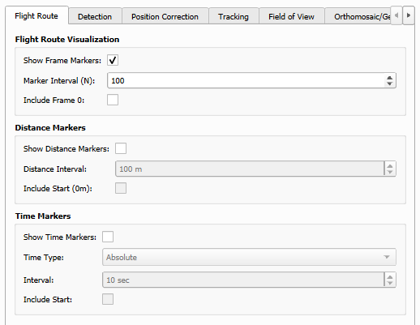
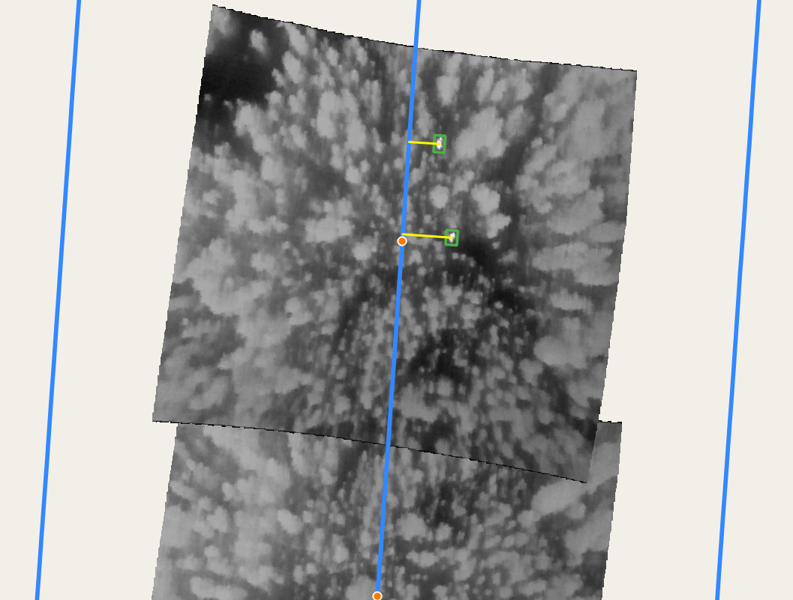
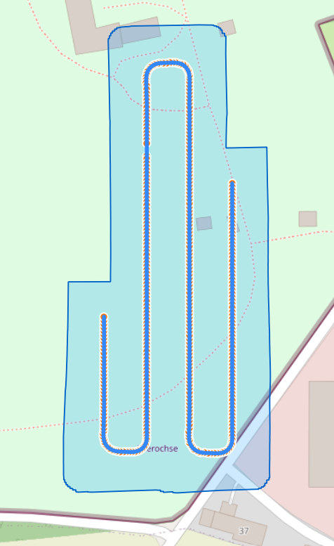
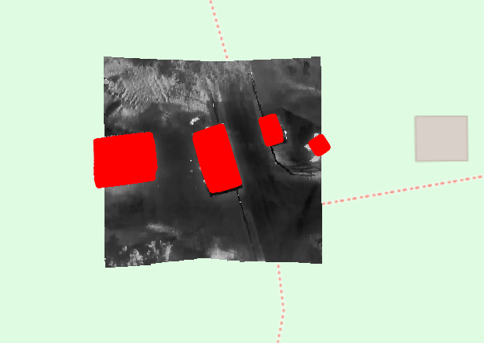

# Processing Pipeline

This guide covers the main workflow of the plugin: configuring inputs, running the processing steps in order, and understanding the outputs.

- [Input](#input)
- [Configuration](#configuration)
- [Processing steps](#processing-steps)
- [Input file formats](#input-file-formats)
- [Output structure](#output-structure)

> **New in 6.0.** Results are stored in GeoPackages rather than text files, a
> QGIS project can hold several flights, and the steps are split across two
> tabs. See [Results, Flights and Export](results-and-export.md) for the
> concepts; this page covers the steps themselves.

## Input

Open the dock widget via the **BAMBI** toolbar icon and select the **input mode** (Video or Photo) in the **Input** tab.

### Video mode

Used when the drone recorded continuous video (thermal and/or RGB). Each camera requires:

| File Type   | Extension | Description                              |
|-------------|-----------|------------------------------------------|
| Video files | `.MP4`    | Drone thermal and/or RGB video recordings |
| SRT files   | `.SRT`    | Subtitle files with per-frame timestamps |
| Calibration | `.json`   | Camera intrinsic parameters              |


### Photo mode

Used when the drone captured a series of still images (e.g. single-shot mapping flights). Each camera requires:

| File Type        | Extension | Description                               |
|------------------|-----------|-------------------------------------------|
| Photo directory  | folder    | Directory containing the still images     |
| Calibration      | `.json`   | Camera intrinsic parameters               |

In photo mode, GPS positions are matched to images via timestamps in the AirData log and the image EXIF data. SRT files are not required.


### Common inputs (both modes)

| Input         | Format            | Description |
|---------------|-------------------|-------------|
| AirData CSV   | `.csv`            | Flight log exported from AirData (GPS positions, altitude, timestamps) |
| Calibration   | `.json`           | Camera intrinsic parameters for undistortion; can be created with the [Camera Calibration Wizard](camera-calibration.md) |
| Correction    | `.json`           | Positional/rotational corrections; can be found interactively with the [Correction Wizard](correction-wizard.md) |
| DEM           | `.gltf` / `.glb`  | Digital Elevation Model + metadata JSON. Provide manually, convert a GeoTIFF, download automatically (Austria), or generate a flat surface mesh; see [DEM Import & Conversion](dem.md) |
| Target CRS    | EPSG code         | UTM-based CRS for the output (e.g. `EPSG:32633` for UTM Zone 33N). The **Auto** button derives a suitable UTM zone from the flight data |
| Flight name   | text (required)   | Name of the flight: titles its layer group and identifies it in the survey tools |
| Target folder | folder path       | Output directory for all generated files |

## Configuration

Before starting processing, configure per-step settings in the **Configuration** tab:



The tab has one sub-tab per topic:

| Sub-tab | Settings |
|---|---|
| **Project** | The project schema: species (with their map colour), enums and custom fields ([Results, Flights and Export](results-and-export.md#the-project-schema)); **Map Symbols**: pins in place of bounding boxes when zoomed out, and the map scale at which they switch ([How animals are drawn](results-and-export.md#how-animals-are-drawn)) |
| **Extraction** | Frame skip, limit, sampling rate, aspect ratio, heading source, AirData margin, **duplicated thermal frames**, timezone, thermal visualisation (see below) |
| **Flight Route** | Frame, distance and time marker intervals |
| **Detection** | Thermal / RGB model, confidence, frame range, **Projection** (camera frames, GeoTIFFs or ALFS integrals), detector class mapping, **custom detector** per camera ([Custom Implementations](custom-implementations.md)) |
| **Position Correction** | Translation and rotation offsets for geo-referencing, default and per frame range ([Correction Wizard](correction-wizard.md)) |
| **Tracking** | Backend, IoU threshold, interpolation, Re-ID model, RGB↔thermal matching, TRex tracklet import, **custom tracker** |
| **Classification** | Projection, crop settings, backbone, the classifier per task (default, model file or **custom implementation**), class mapping, voting, the size-based age estimate ([Classifier configuration](tools.md#classifier-configuration)) |
| **Field of View** | Custom mask, simplification, frame range and sample rate |
| **ALFS/GeoTiff** | Ground resolution or fixed render size, frame range and step, crop to content, overviews, tile size, sampling mode; edge erosion of the frame GeoTIFFs |
| **Orthomosaic** | Merge mode, frame range |
| **Environment** | Sentinel-2 scene window and required clear share, buffer around the flight, whether to extend to the survey area ([Environmental Context](environment.md#configuration)) |


### Extraction

The **Extraction** sub-tab provides fine-grained control over which frames are processed and how thermal images are rendered.


| Setting | Description |
|---------|-------------|
| **Skip first** | Skip this many frames/images at the start before processing begins. Useful for ignoring take-off frames. |
| **Limit** | Cap the total number of frames processed (enable the checkbox to activate). |
| **Sampling rate** *(video only)* | Take every N-th frame (e.g. 5 = every 5th frame). Reduces processing time for long recordings. |
| **Keep duplicated thermal frames (flagged)** *(thermal video only, on by default)* | A thermal camera closes its shutter now and then to recalibrate; while it is closed the video repeats the previous image. Ticked, these frozen frames stay in `poses_t.json`, marked `"duplicated": true`, so the frame index equals the video's frame number (one video, no skip or sampling). Unticked, they are dropped as before 9.0.0 and all later frames move up. See [Duplicated frames](#duplicated-frozen-thermal-frames). |

**Thermal visualisation** (requires the DJI Thermal SDK, installable via the [Dependency Manager](installation.md#dependency-manager); the group is greyed out when the SDK is not detected):

| Setting | Description |
|---------|-------------|
| **Colormap** | Apply a false-colour map to the exported thermal frames (e.g. `plasma`, `inferno`, `jet`, `white-hotspot`). Choose `(none)` to keep raw 8-bit grey values. |
| **Tone mapping** | `Thresholds (lower/upper)` for a linear stretch with optional black clipping, or `Curve (custom mapping)` for a fine-granular, style curve. |
| **Lower threshold** | *(threshold mode)* Pixels below this temperature (°C) are rendered black. Enable the checkbox to activate. |
| **Upper threshold** | *(threshold mode)* Pixels above this temperature (°C) are rendered black. Enable the checkbox to activate. |
| **Curve** | *(curve mode)* Opens the curve editor: a tone curve maps a fixed temperature range to display intensity via draggable control points (left-click adds/drags, right-click removes). Because a flight's temperature bounds are usually unknown, the range can be entered manually or filled by **Auto Detect**, which scans all images in the thermal photo directory for the actual minimum/maximum (optionally ignoring the extreme 1 % to suppress dead/hot pixels). Temperatures outside the range clamp to the curve's endpoint values instead of turning black. The curve is saved with the project. |

### Duplicated (frozen) thermal frames

A frozen frame has a **valid pose** (position, rotation, timestamp) but the
**wrong image** - it shows what the camera saw before the shutter closed.
The frame list is never shortened, so frame numbers stay what they are;
instead each step decides what to do with a flagged frame:

| Skipped (the image would give a wrong result) | Kept, only marked (the pose is what counts) |
|---|---|
| Detection, thermal↔RGB frame matching and track matching, field of view (and with it transect area), ALFS, GeoTIFFs (and with them orthomosaic and coverage map), segmentation, embeddings and classification crops, COCO / YOLO / Camtrap DP export, label boxes (interpolated or propagated), the Correction Wizard, and in the 3D Flight Viewer the trail, live ALFS, auto-refine, frame comparison and the thermal reconstruction texture | Flight route and camera positions (with a `duplicated` attribute), transects, the height profile, track times; the click, transect, labelling and segmentation tools, the 3D Flight Viewer and the video creator show a ❄ "frozen frame" note |

Detection simply has no boxes on a frozen frame; the track interpolation
closes the gap like any other missed frame.

**Changing the setting renumbers the frames.** Re-extracting with the other
setting asks for confirmation, and everything computed from the previous
frames is marked out of date. Labels and frame-range corrections refer to the
old numbers and have to be checked by hand. Flights extracted before 9.0.0
had their frozen frames dropped.

### TRex tracklet import

If you have already tracked animals externally with [TRex](https://trex.run), the plugin can import those tracklets instead of running its own tracker. In the **Tracking** sub-tab, set the **NPZ Folder** to the directory containing the TRex `*.npz` tracklet files.

- Check **Labels already in undistorted frame space** if TRex was run on already-undistorted BAMBI frames; leave it unchecked (default) if TRex was run on the original raw video
- **Frame numbers:** TRex counts frames as the video does, and that number is used as the frame index. Extract the thermal frames with **Keep duplicated thermal frames** ticked (the default), from one video, without skip or sampling - otherwise every box after the first frozen frame is placed with a later pose. The import warns when the frames were extracted with duplicates dropped, and leaves out boxes on frozen frames.
- When an NPZ folder is set, step **4. Track Animals Or Import** imports and geo-references the TRex tracklets instead of running the configured tracking backend

What the import records is what the plugin's own steps record: every tracklet is a **track**, each of its frames a **box** - under a source of their own, so detecting again leaves them alone. The boxes are stored in the pixels of the **extracted frames**: boxes made on the raw video are undistorted with the camera's calibration first, the way the extraction undistorts the frames. Their **positions** are then computed by *Geo-Reference Detections* itself, as part of the import and for every box of the camera, so a box that cannot be placed (no pose for its frame, off the DEM) is recorded with the reason rather than dropped. The text files (`detections.txt`, `tracks_pixel.csv`, `tracks.csv`, …) are written only while **Also write legacy text outputs** is on.

> Before 9.1 the import wrote the positions to the text files only, which nothing reads since 6.0 - imported tracklets could not be added to the map or analysed. Import them again to get their positions.

## Processing steps

The steps live on two tabs, split by what they depend on:

| Tab | Steps | Depends on |
|---|---|---|
| **Pre-Processing** | P1 Extract Frames, P2 Generate Flight Route, P3 Calculate Field of View, P4 Generate ALFS, P5 Export Frames as GeoTIFF, P6 Generate Orthomosaic | the drone poses and the DEM - **no animals involved** |
| **Pre-Processing** (*Environmental Context*) | E1 Satellite Indices, E2 Land Cover, E3 Terrain Wetness, E4 Weather - see [Environmental Context](environment.md) | the flight's extent and date; **camera-independent**, each source its own sub-step |
| **Processing** | Three sections: *Detection and Tracking* (A1 Detect Animals with geo-referencing and perpendicular distances, A2 Track Animals Or Import, A3 Match RGB ↔ Thermal Tracks with label sync), *Classification* (C1 embeddings, C2 occlusion, C3 species, C4 sex, C5 age), and *Segmentation* (S1 opens the [Segmentation Tool](tools.md#segmentation-tool)) | the detections |

The numbering is prefixed so a bare number cannot mean two different steps.
They are *not* one sequence: only P1 is a prerequisite for the Processing tab.
Re-running detection marks the Processing steps out of date and leaves the ALFS
and orthomosaic alone.

The **→** buttons below each step load the corresponding results into QGIS as styled layers, or compute derived products. Layers are grouped under the active flight's name, per camera (see [Layer groups and order](results-and-export.md#layer-groups-and-order)).

**Camera selection.** Each stage has one selector at its top, instead of one
per step (since 9.0.0):

| Stage | Selector | Applies to |
|-------|----------|------------|
| Pre-Processing steps | **Camera** (Thermal / RGB) | P1 extraction, flight route, FoV, ALFS, GeoTIFFs, orthomosaic |
| Detection and Tracking | **Camera** (Thermal / RGB) | detection, geo-referencing, perpendicular distances, tracking (matching always uses both) |
| Classification | **Input** (Thermal / RGB / Matched) | C1 embeddings and all classifiers |

The step statuses show the selected camera's outputs. To process both
cameras, run the stage once per selection.

Progress, the abort button and the log sit below the tabs, so they are visible whichever tab a step was started from.


### P1. Extract Frames

Extracts, undistorts, and geo-tags frames from the input data.

- **Video mode**: Decodes frames from thermal/RGB video files; timestamps from SRT logs are matched with AirData GPS positions to compute camera poses
- **Photo mode**: Reads still images from the specified directories; image timestamps (EXIF) are matched with AirData GPS positions to compute camera poses

**Outputs:**
```
frames_t/          # Undistorted thermal frames
frames_w/          # Undistorted RGB frames
poses_t.json       # Camera pose for every thermal frame
poses_w.json       # Camera pose for every RGB frame
mask_T.png         # Undistortion mask (thermal)
mask_W.png         # Undistortion mask (RGB)
```

> **Note:** For large datasets or long videos this step may take several minutes. Progress is updated between frames.

**Square or not.** Frames are written square (1:1) unless **Preserve original aspect ratio** is ticked. Every step and tool reads the shape off the frames themselves, so both work - since 9.1 also in the inspector (the boxes shown in the other camera, the cross hair of a map click) and in the Correction Wizard, which until then assumed square frames and placed everything on a 16:9 frame too far from the image centre.

**Extracting again** replaces the frames: every image is written anew, so a changed calibration or "preserve aspect ratio" shows in the pictures and not only in the poses and the mask, and video frames of the earlier extraction that the new one does not have (another sampling rate or range) are removed from the folder. Other files in the folder are left alone. Everything computed from the previous frames is marked out of date. An extraction that is aborted half-way leaves some new images under the previous frame list - the log says so; run it again before using the frames.

### P2. Generate Flight Route

Builds two complementary vector layers from the mission data:

- **Flight route line**: GPS positions recorded in the AirData CSV are projected to the target UTM CRS and connected as a `LineString`. This represents the true GPS-recorded flight path.
- **Camera position points**: The position of the drone at every extracted frame (from `poses.json`) is added as a separate point layer; these are the positions at which images were actually captured.

**Outputs:**
```
flight_route_t/    # or flight_route_w/ depending on camera selection
├── flight_route.geojson       # GPS-based flight path (LineString)
└── camera_positions.geojson   # Per-frame camera positions (Points)
```

Use **→ Add Flight Route to QGIS** to load both layers with styling applied.

> **Note:** Frame extraction (P1) is optional for this step. If no `poses.json` exists yet, only the AirData-based flight route line is generated (a warning is shown), which is useful for a quick overview of the flight before running any extraction. Camera positions, frame/distance markers and image labels require P1; re-run this step after extraction to add them.


### A1. Detect Animals

Runs YOLO-based detection on all extracted frames. Separate model paths can be configured for the thermal and the RGB modality; the model matching the selected camera is used. The default wildlife detection model for each modality is downloaded automatically from HuggingFace on first use - the version this plugin release was tested with, fetched at the commit of its repository and checked against its published size and SHA-256 (so is every other default model: the Re-ID weights, the classifiers, the DINOv3 backbone and SAM3). A model therefore does not change under a survey unless the plugin is updated or you choose another one.

**Projection** (Configuration → Detection): detection normally looks at the
extracted camera frames (*Perspective*). With *Orthorectified (GeoTIFF)* it
looks at the per-frame GeoTIFFs instead - for detectors trained on orthophotos,
built-in or [custom](custom-implementations.md). *Export Frames as GeoTIFF* has
to have run for the camera (frames without a GeoTIFF are skipped) and the DEM
is needed. The detector's boxes are then raster pixels, and their world
position follows directly from the GeoTIFF; what the plugin adds is the box's
place in the **camera frame** (through the DEM and the frame's corrected
camera), because a detection is stored as a box in the extracted frame - the
picture the labelling tool, the inspector, the video creator, the classifiers'
crops and the image exports draw it on. From there on it is a detection like
any other: geo-referencing, tracking and everything after work unchanged. A
box that falls outside the DEM or its camera frame is dropped and counted in
the log. The default BAMBI models were trained on perspective frames.

*ALFS (light-field integrals)* works the same way on the integrals of **ALFS
sampling mode** (*Generate ALFS* with sampling enabled): one integral per
central frame, focused on the DEM, in which occluding vegetation is blurred
away. Only the central frames have an integral, so only those are searched;
the boxes are placed in the central frame's camera image. It is there for
detectors trained on ALFS imagery ([custom](custom-implementations.md) ones
today). The Classification tab's **Projection** has the same third option
for the crops of the embedding step and of custom classifiers - a frame
between two central frames then uses the nearest integral; no default
classifiers have been published for ALFS imagery yet.

**Outputs:**
```
detections_t/    # or detections_w/ depending on camera selection
└── detections.txt    # Bounding box detections (frame, x1, y1, x2, y2, confidence, class)
```

Manual annotations created with the [Labelling Tool](tools.md#labelling-tool) can be added alongside the detector's output (via its **Add detections to project** button) - or can replace it entirely (via **Replace detections in project**, after confirmation). They are geo-referenced like regular detections. A label track is a track already, so the trackers leave its boxes out and associate only the detector's: a labelled animal is one track, not two.

Since 6.0 the two never interfere: each producer owns its own rows, so
re-running the detector leaves manual labels untouched and vice versa. Editing
a label re-uses the detections it already produced, so only the boxes that
actually moved need geo-referencing again.

**Detecting again replaces the detector's boxes of that camera** - also when another model is selected. The class mapping is kept per model, but only the boxes of the latest run exist; they do not pile up next to those of the model that ran before.

#### → Geo-Reference Detections

Projects pixel-space bounding boxes to real-world UTM coordinates by ray-casting against the DEM mesh. Each detection's four corners are projected and the result is stored as a world-space bounding box.

**Outputs:**
```
georeferenced_t/    # or georeferenced_w/, follows the detection camera selection
└── georeferenced.txt    # Detections with UTM bounding box coordinates
```

Use **→ Add Detections to QGIS** to load per-frame detection layers. Zoomed in, each detection is its bounding box, in the colour of the track it belongs to; zoomed out it becomes a pin in the colour of its species, with sex and age on it - see [How animals are drawn](results-and-export.md#how-animals-are-drawn).


Detections whose ray never reaches the DEM - sky above the horizon, ground
beyond the DEM edge, a frame with no pose - are recorded with the reason rather
than dropped, so every detection is accounted for afterwards.

#### → Calculate Perpendicular

For each geo-referenced detection, computes the **perpendicular distance** to the flight route:

1. The 2D center of each detection's bounding box is computed
2. The nearest point on the AirData GPS `LineString` is found by projecting onto each segment
3. The Euclidean distance between the detection center and the foot point is recorded

This is particularly useful for **transect-based wildlife surveys**, where the perpendicular offset from the flight line is a key sampling variable.

**Outputs:**
```
flight_route_t/    # or flight_route_w/, uses the flight route camera selection
├── perpendicular.json             # Flat list (used by QGIS layer)
└── perpendicular_by_image.json    # Per-image keyed results
```

`perpendicular_by_image.json` structure:
```json
{
  "frame_000042.jpg": {
    "0": {
      "center": [UTM_x, UTM_y, altitude],
      "perpendicular": [foot_x, foot_y, altitude],
      "distance": 12.34
    }
  }
}
```

Use **→ Add Perpendicular Lines to QGIS** to visualize the connections as line features with a `distance_m` attribute.



### A2. Track Animals Or Import

Associates detections across frames into continuous tracks using the selected tracking backend. If a TRex NPZ folder is configured (see [TRex tracklet import](#trex-tracklet-import)), the pre-computed TRex tracklets are imported and geo-referenced instead.

- Tracks with a single detection (no movement) are fully supported and appear as a bounding box without a movement line
- Multi-detection tracks show both the movement path and the final bounding box

**The built-in tracker** works on the geo-referenced boxes, frame by frame: each box of a frame either continues a track or opens a new one. How boxes and tracks are matched is the **Tracker Mode** (Configuration → Tracking):

| Mode | Boxes and tracks are matched |
|------|------------------------------|
| `GREEDY` | by overlap (IoU), the best pair first |
| `HUNGARIAN` (default) | by overlap, taking the assignment with the most overlap in all |
| `CENTER` | by the distance between the box centres, nearest first |
| `HUNGARIAN_CENTER` | as `HUNGARIAN`, then as `CENTER` for what overlap could not pair |

**IoU Threshold** is the smallest overlap that joins a box to a track (the three overlap modes); **Max Center Distance** the largest distance between the centres, in metres on the ground (the two centre modes) - the form enables the one the mode uses. The centre modes are for animals whose consecutive boxes do not overlap: a small animal, a low frame rate, a jump in the position. **Max Age** ends a track that went unmatched for more than that many frames; only frames that have boxes count, so the thermal camera's shutter does not end tracks. **Class Aware** never joins boxes of different species, and **Interpolate Missing** fills the frames a track skipped with boxes in between (in the text output; they are not detections).

**Abort** stops a tracker between two frames, before anything is written: the previous tracks stay.

**Outputs:**
```
tracks_t/    # or tracks_w/, follows the detection camera selection
├── tracks_pixel.csv    # Tracks in pixel coordinates
└── tracks.csv          # Geo-referenced tracks (UTM)
```

Use **→ Add Tracks to QGIS** to load each track as a grouped layer (movement path + final bounding box). Every track has a colour of its own for its box and path; zoomed out, the box becomes a pin in the colour of the track's species, with the sex in its middle and the age as a badge - see [How animals are drawn](results-and-export.md#how-animals-are-drawn).

The tracks are read from the store (`bambi_t/tracks.gpkg`), so the button works whether or not the two text files above were written - they are only there while **Also write legacy text outputs** is on - and it shows animals that were labelled by hand as well, which are never written to them.


#### → Calculate Track Perpendicular

For each track, takes the **last bounding box** (the animal's final recorded position) and calculates the perpendicular distance to the flight route, using the same method as the detection perpendicular step.

**Outputs:**
```
flight_route_t/    # or flight_route_w/, uses the flight route camera selection
├── perpendicular_tracks_t.json             # Flat list (used by QGIS layer); _w for the RGB tracks
└── perpendicular_tracks_by_track_t.json    # Per-track keyed results
```

`perpendicular_tracks_by_track_t.json` structure:
```json
{
  "42": {
    "detection_id": 1873,
    "last_frame": 123,
    "last_image": "frame_000123.jpg",
    "center": [UTM_x, UTM_y, altitude],
    "perpendicular": [foot_x, foot_y, altitude],
    "distance": 35.7
  }
}
```

Use **→ Add Track Perpendicular Lines to QGIS** to visualize as line features.

The distance is also the **Distance to the flight line** column of the [track inventory](#track-inventory) (`perpendicular_distance_m`). A distance is shown for a track only when it was measured from one of that track's own boxes - after tracking again the tracks are numbered anew, so run this step again to fill the column. (Before 9.1 the column was always empty: the inventory misread the file.)

### P3. Calculate Field of View

Computes the camera footprint polygon on the ground for each frame (or a subset), using the DEM for accurate terrain-following projection.

**Outputs:**
```
fov_t/    # or fov_w/ depending on camera selection
├── fov_polygons.txt      # Per-frame FoV polygon coordinates
└── merged_fov.geojson    # Union of all footprints (coverage area)
```




### P4. Generate ALFS

Creates a georeferenced Airborne Light Field Sampling (ALFS) by projecting all (or a subset of) frames onto the DEM surface and blending them together. Output is a Cloud-Optimized GeoTIFF.

The mosaic spans the whole DEM and is rendered in tiles of at most the *tile size*. A tile gets the frames that can see it - worked out from each frame's position, direction and field of view - and a tile no frame sees is not rendered at all; the log says how many those were. (Up to 9.0 such a tile had **every** frame of the flight rendered into it before it was found empty, which made the step slower the larger the DEM was compared to the flight; and a camera tilted away from straight down could be left out of tiles its frames reached.)

**Outputs:**
```
alfs_t/    # or alfs_w/ depending on camera selection
└── alfs.tif    # Georeferenced mosaic (COG GeoTIFF)
```


### P5. Export Frames as GeoTIFF

Exports individual frames as georeferenced GeoTIFFs, suitable for import into GIS tools or for detailed per-frame analysis.

**Outputs:**
```
geotiffs_t/    # or geotiffs_w/ depending on camera selection
├── frame_000000.tiff
└── ...
```


### P6. Generate Orthomosaic

Builds a **true orthomosaic** by mosaicking the individually orthorectified frame GeoTIFFs from P5 into a single georeferenced raster. Unlike the ALFS product (an integral light-field image), this merges the exported GeoTIFFs with `rasterio`, so P5 must be run first for the selected camera.

Like the other steps you can use **all** exported GeoTIFFs or restrict to a **frame-index range**, choose the **camera** (Thermal / RGB), and pick the **merge mode** that resolves overlapping pixels:

- **First**: the first frame covering a pixel wins (default)
- **Last**: the last frame covering a pixel wins
- **Min**: the darkest overlapping value wins
- **Max**: the brightest overlapping value wins
- **Average**: the mean of all overlapping frames (smooths seams; slower, two-pass)

**Outputs:**
```
orthomosaic_t/    # or orthomosaic_w/ depending on camera selection
└── orthomosaic.tif    # Merged georeferenced orthomosaic (LZW GeoTIFF with overviews)
```

### Classification

Works out **what** each tracked animal is: whether a frame shows it clearly, what species it is, its sex, and whether it is a juvenile. Implements the pipeline of *When One Modality Is Not Enough: Multimodal Sex and Life-Stage Classification of Red Deer from Aerial RGB–Thermal Video*.

> **Tracks you annotated in the labelling tool are never changed by these steps.** A hand annotation outranks a model: the classifiers fill in what is missing and leave your own work alone.

The reason this is worth doing in two sensors rather than one is that they fail in opposite conditions. In colour a deer under canopy blends into the ground; in thermal it is an unmistakable bright blob but the fur colour is gone, and antlers only show while they are still growing and warm. Which sensor carries the sex cue therefore changes with the season - which is why the *matched* option, reading both at once, is the default.

> **Requires a Hugging Face token.** The DINOv3 model these classifiers read is *gated*: request access at [huggingface.co/facebook/dinov3-vith16plus-pretrain-lvd1689m](https://huggingface.co/facebook/dinov3-vith16plus-pretrain-lvd1689m), then paste a read token into **Configuration → Classification** and press **Check access**. See [Installation](installation.md#classification).

#### A3. Match RGB ↔ Thermal Tracks

Decides which thermal track and which RGB track are the same animal, by registering the two views onto each other and comparing where the boxes sit. Needs both cameras tracked; there is no camera selector, because the step is inherently about the pair.

Confirmation is what keeps a census honest. An animal both cameras saw is a real animal; a track only one camera saw is either an animal the other sensor cannot make out, or noise. In the paper's four test flights, of 34 tracks without a partner only *one* was a real animal - admitting them all would have added six individuals that did not exist.

Each track is paired with at most one track of the other camera, and the pairing is chosen for all tracks together: the one with the smallest total distance, where a track that stays without a partner counts as half the gate. A pair is therefore taken exactly when it is closer than the gate, and a clearly right pair is not given up to squeeze in two that barely clear it. (Up to 9.0 the pairing matched as many tracks as it could before it looked at a distance, and in a herd could drop the right pair for two marginal ones.)

The run log reports how many pairs were confirmed out of how many raw tracks. If nothing matches, it names which gate rejected everything and how far the closest candidate was, so you can tell "there were no animals" from "the gate is wrong for this resolution".

**→ Add Matched Pairs to QGIS** draws a line between each pair's positions, attributed with the shared frame count and median distance - the quickest way to see whether the gate is set sensibly.

**→ Sync Labels Across the Match** copies species, sex and age from one camera's animals onto their matched partners on the other (direction selectable: *Thermal → RGB* or *RGB → Thermal*), and the per-frame occlusion onto the paired detections. Only matched pairs are touched; an animal that already carries an answer keeps it, and hand annotations from the labelling tool are never overwritten. It is what lets a classifier that only works on one camera label the animals of both.

The step sits in the *Detection and Tracking* section (it needs both cameras tracked, nothing else); the classification stage builds on it whenever its **Input** is *Matched*.

**Outputs:**
```
matches.gpkg    # beside project.gpkg: a match belongs to neither camera
```

#### C1. Compute DINOv3 Embeddings

Describes every tracked animal's crop as a feature vector, once, so all three classifiers can reuse it. This is the expensive step - the model is large, and on CPU it takes minutes per hundred crops.

Vectors are written beside the frames, one file per frame, so they are reusable outside the plugin. A re-run only embeds what is missing: an interrupted run resumes rather than starting again, and changing the crop settings starts a new set without discarding the old one.

**Outputs:**
```
embeddings_t/            # or embeddings_w/
└── non_geo/             # or geo_1k/ geo_2k/, per the chosen projection
    └── frame_000123.npz # one array per detection, named det_<id>
bambi_t/classification.gpkg   # which detections are embedded, and by which run
```

#### C2–C4. Occlusion, Species and Sex Classification

One step each, run in that order, because each depends on the one before:

1. **Occlusion**, per frame, labels a crop *clear* or *occluded*. It is a quality filter, not a verdict about the animal, so it produces no per-animal answer - and it is **optional**.
2. **Species** votes across the frames that are worth trusting, and its majority fixes what the animal is. The published model knows red deer, roe deer and wild boar - anything else is forced into one of the three, so on a survey with other animals check the class mapping or leave the task off.
3. **Sex** reuses *exactly those frames*, and picks its model from the species just assigned.

Voting is what makes a noisy per-frame call safe. An antler only resolves from some angles, so many frames of a true male look female; the majority still recovers him. The margin behind every call is kept - "male, 106 of 115 frames" is what lets you judge a borderline animal - and you can re-vote at a different quorum without re-running anything.

An animal the classifier cannot call is **left unknown, never discarded**: it keeps its place in the census with the attribute blank.

**The animals follow the latest run.** Running a classifier again - with another model, or re-voting at another quorum - replaces what the earlier run wrote, on the track and on its boxes (which is where the exports and the analytics read the species), and takes a call back from an animal the new run no longer calls. Only what a classifier wrote is replaced or taken back: a species from the detector's class mapping, a value synced across from the other camera after the call, and hand labels stay.

**Frames used** decides what may vote. *Visible frames only* is decided frame by frame, by the best that is known about that frame: the occlusion classifier's call where it has one, otherwise the occlusion value stored on the box (what the labelling tool writes), and otherwise the frame votes - nobody called it occluded. The run log says which of these the tracks went by, and how many frames voted without a label. (Up to 9.0 a frame without a label counted as occluded as soon as any box of the flight had one: a single hand-labelled track left every other track without a frame to vote with, and so without a species.)

**Unmatched animals** decides what happens to an animal only one camera saw when a classifier's **Input** is *Matched* - such a classifier reads both cameras side by side and cannot take a blank for the missing one. *Skip the animal* leaves it uncalled. *Fall back to RGB / thermal* hands it to the published classifier of that one camera for the same task, and the stored result of each frame names which of the two called it; the log says how many frames went that way. A model file of your own has no single-camera counterpart, so its unmatched animals are skipped (the log says so). (Up to 9.0 the fallback handed the matched classifier the one camera's vector, which is half as wide as its input: the classifier refused it and the whole run stopped.)

**Applying the classifications to tracks and detections** copies the answers onto the animals themselves, which is what makes them visible to the exports, the map layers, the survey analytics and the labelling tool. It runs automatically unless switched off, and is safe to repeat.

#### C5. Age Classification

Flags juveniles by body size - the **fallback** where no classifier called the animal.

Life stage comes from whatever you chose for that species. Under the life-stage classifier's **Species…** button each species is set to **Size-based**, a model, or **Off** - one decision in one place, rather than a model choice plus a switch somewhere else. Size-based is the default, because no life-stage model has been published yet; a species set to a model is called by it in C3 and left alone here, and one set to Off is not called at all.

Needs no models - only tracks, and geo-referencing if the metric areas are to be used.

A juvenile cannot be told from an adult female by appearance at survey resolution, which is exactly why the sex classifier's second class is *female/juvenile*. Size settles it: a juvenile sits far below its cohort **and** a clear gap separates it from the herd - directly above it, or above another animal as far below the median as it is. Both conditions are required, because in any herd someone is smallest and that alone is not evidence. Twins are both juveniles: the smaller of two fawns of a size is a hair below its sibling, and the gap that counts is the one over the two of them (up to 9.0 only the larger twin, the one next to the gap, was called).

Sizes are only ever compared **within one flight** - how tightly boxes fit varies between recordings, enough that the paper's own juvenile from one flight lands inside another flight's adult range. There is deliberately no absolute threshold.

... and **within one species**. A roe deer is half the size of a red deer at any age; measured against a herd of red deer an adult roe deer is exactly the low outlier the rule looks for, and up to 9.0 - when all animals of a flight were one cohort - it was called a juvenile. An animal's species is the species classifier's call, else the one on its track, else what the detector called most of its boxes. The animals nobody identified are compared with each other (on a flight without any species that is everyone, as before), a species with fewer animals than **Min individuals** is not judged at all - the other species' are no measure for it - and a track that is `not-an-animal` is neither judged nor part of anyone's cohort. The log has one line per species.

Areas come from the **geo-referenced** boxes where geo-referencing has run, which makes them metric; otherwise from the camera-frame boxes, which still work because the comparison never leaves the flight. Which was used is recorded with every verdict, so metric and pixel figures are never mixed. Animals a classifier already called still count towards the cohort statistics - excluding them would shift everyone else's score - they simply do not take a verdict from it.

On a flight with only a handful of animals the test declines to call one, because the candidate sits in the lower half of the distribution and so widens the very spread it is measured against. The log says so rather than reporting a bare "no juvenile found": a cautious answer and an empty one look identical otherwise.

Each camera is measured as **its own cohort** - a thermal sensor and an RGB sensor frame the same animal differently, so their areas are never pooled. Where tracks have been matched across cameras (A3), a juvenile found on one camera is **carried onto its partner track** on the other. The thermal cohort is often the one that cannot confirm a calf: it holds every warm blob the detector tracked, species-less and frequently one frame long, which pads out the lower end of the distribution until an animal at half the median is nothing special - while among the RGB deer the same animal is a clear outlier. Only size verdicts move: an animal a classifier called keeps that answer, *adult* is never carried because it is the absence of an outlier rather than a finding, and a camera the stage did not measure receives nothing. The carried verdict records which partner it came from, and the track inventory shows it as `matched RGB track N` in the `age_source` column.

**Outputs:**
```
bambi_t/classification.gpkg
├── frame_predictions    # per crop: label, probability, model
└── track_predictions    # per animal: the call, and the vote behind it
```

### S1. Open Segmentation Tool

Segmentation is interactive - a prompt, a look at the mask, another click - so it is a window of its own rather than a step: the [Segmentation Tool](tools.md#segmentation-tool), also on the toolbar. It prompts SAM3 / SAM 3.1 with **text** ("deer") or **clicked points** on the extracted frames of either camera, on single frames or **tracked across a sequence**, through the Roboflow API, `transformers`, or Meta's official `sam3` package. The window also geo-references the masks onto the DEM, adds them as QGIS layers and exports them as GeoJSON.

**Outputs:**
```
segmentation_t/    # or segmentation_w/ depending on the camera
├── segmentation_pixel.json     # Pixel-space mask polygons per frame and prompt
└── segmentation_georef.json    # The same polygons in UTM coordinates (after geo-referencing)
```



## Survey analytics

The **Survey Analytics** tab (next to *Processing*) turns geo-referenced
detections, tracks and exported frames into population-level products. It is
**not tied to the flight selected on the other tabs**: a survey is a set of
processed flights analysed together.

### The survey: flights, camera, folder

The box at the top of the tab defines the survey every tool below works on:

| Setting | |
|---|---|
| **Flights** | Tick the processed flights of this QGIS project that make up the survey. Their counts, areas and distances are pooled; the census summary also lists them one by one. A flight that has not been processed, or whose folder is missing, cannot be ticked. |
| **Camera** | Thermal or RGB - whose detections, tracks, footprints and transects are analysed. The flights must have been processed for it. (This is the survey's own selector; it is independent of the stage selectors on the processing tabs.) |
| **Count** | What every tool on the tab counts. **Animals (tracks)** - the default - counts each tracked animal once, at the centre of its boxes, with the species, sex and age of the track. **Boxes (detections)** counts every geo-referenced box: what a still-photo survey without tracking has - an animal on two photos counts twice. |
| **Survey folder** | Where the survey results (`analytics_t/` / `analytics_w/`) and the survey area are stored. Empty = `bambi_survey` next to the QGIS project - next to the first ticked flight while the project has not been saved. **A survey folder that holds results stays where it is**: when saving the project (for the first time, or somewhere else) or ticking another flight first would move the default, the folder used so far is entered in the field instead, and the log says so. Empty the field to go to the new default, or enter another folder, to move the survey yourself. |

Four things hold for every tool:

- **One CRS.** Pooled points, rasters and areas need the ticked flights to
  share their target CRS; this is checked, not assumed.
- **Species by name.** Species ids are assigned per flight, so the species
  filter works on names. A name missing from a flight is not an error - that
  flight simply has none of it.
- **What was counted is recorded.** Each result notes the tracking run used,
  whether manual tracks were included, the species filter, and how many
  detections labelled `not-an-animal` were excluded. One tracker run
  contributes (built-in, BoxMOT and TRex describe the same animals, so pooling
  two would double-count), and manual tracks are *added* to it. A label created
  with *Import as label track* replaces the tracker track it came from. See
  [Results, Flights and Export](results-and-export.md#what-the-analytics-counted).
- **An animal is one thing in every tool.** A tracked animal has one
  species: the track's own where it was identified - by a classifier, by
  hand, or synced across from the other camera - and otherwise what most of
  its boxes were called by the detector's class mapping. It has one position,
  the centre of all its boxes, and the sex and age of its track. A track that
  is `not-an-animal` by that rule is not counted. Up to 9.0 the tools asked
  different things - the census and the inventory the track (`animal` for
  every track no classifier had named), the heatmap each box (an animal
  called roe deer on two frames and chamois on a third counted once for
  each), distance sampling and the population estimate the last box - and so
  disagreed about the same animals. A box, when the survey counts boxes, is
  what the box itself was called, with the sex and age of the animal it
  belongs to.

**One setting decides what is counted.** Up to 9.0 the census, the density
heatmap and distance sampling each had a selector of their own, with
different defaults - the census counted animals, the other two boxes - so the
same survey was three different things depending on the tool, and a density
of boxes is not a density of animals. The **Count** setting of the survey box
now applies to all of them, and is saved with the QGIS project. The
population estimate and habitat use, which only knew tracks, follow it too,
so a still-photo survey without tracking can use every tool. Census, heatmap
and distance-sampling results are still written per choice (`..._tracks` /
`..._detections`), so switching does not overwrite the other set; the
population estimate and the habitat summary record what they counted
(`source`).

### Survey area and exclusion zones

A census is usually reported for a defined area - a hunting district, a
reserve, a forest compartment - not for whatever ground the flights happened
to see. The **Survey Area** box holds that area:

- **Survey areas** - one or more census polygons. An animal counts when it is
  inside any of them, and only the ground inside them is surveyed area
  (overlapping areas count once).
- **Exclusion zones** - ground removed again, each with an optional reason
  (thick forest cover, a building, a road). Animals there are not counted and
  their ground is not part of the area.

`effective area = union(survey areas) − union(exclusion zones)`. Exclusion
zones may be defined without a survey area; they are then cut out of the
whole flights.

**Draw Survey Area** / **Draw Exclusion Zone** add the layer, switch it to
editing and start the polygon tool (click the vertices, right-click to finish,
save the layer edits). **Import…** copies polygons from a layer already in the
project - a shapefile of the hunting districts, a KML, a GeoJSON. The polygons
live in `<survey folder>/survey_area/survey_area.gpkg`, an ordinary
GeoPackage edited with the normal QGIS tools.

With **Limit analytics to the survey area** ticked, the census, density
heatmap, coverage map, distance sampling and population estimation count only
animals inside a survey area and outside every exclusion zone, and use only
that ground as the surveyed area. Unticked, they cover the whole flights. The
survey orthomosaic is never clipped.

### Census summary

The plain census figures a survey report starts from: how many of each
species were counted, how many of them inside the survey area, how many per
km², and how they split by sex and age - per flight and for the survey as a
whole. No detection-function model is involved; these are minimum counts.

What is counted - animals or boxes - is the survey's **Count** setting.

Two densities are reported, because which is right depends on the survey:

- **per plot** - the survey area minus its exclusion zones. Right when the
  flights together cover the area completely: adjacent flights add up to one
  census, `sum(counts) / plot area`.
- **per covered ground** - the ground the frames actually saw inside the area
  (the union of the field-of-view footprints). It does not assume full
  coverage, and across flights it is `sum(counts) / sum(covered areas)` -
  right for repeat flights over the same plot as well.

An animal without a geo-referenced position is counted, but with a survey
area it is reported as *unplaced* rather than inside. **→ Show Census Table**
opens the result as a table.

**Outputs:**
```
analytics_t/    # or analytics_w/, in the survey folder
├── census_summary_tracks.csv    # or census_summary_detections.csv
└── census_summary_tracks.json
```

### Density heatmap

Generates a **kernel-density estimate raster** of animal locations. Points are binned to a grid and smoothed with a Gaussian kernel; each output pixel is the estimated density in **animals per hectare**.

| Setting | Description |
|---------|-------------|
| **Cell (m)** | Output raster cell size in metres (default 5 m) |
| **Bandwidth (m)** | Gaussian smoothing radius in metres (default 25 m) - larger values give smoother, broader hotspots |

**Outputs:**
```
analytics_t/    # or analytics_w/
├── density_tracks.tif    # or density_detections.tif - float32 GeoTIFF (points/hectare)
└── density_tracks.json   # stats: peak/mean density, point count, parameters
```

Use **→ Add Density Heatmap to QGIS** to load the raster with a blue→red colour ramp scaled to the data.

**A zero is a result, and no data is something else.** The raster tells three things apart:

- ground that is known to have been surveyed carries its density - **`0` where no animal was**. "Known" is the survey area where one is switched on, else the cameras' footprints (run **Calculate Field of View** for the survey's camera); with both, the footprints inside the area. The raster reaches as far as that ground does.
- everything outside it is **no data** (transparent).
- where neither a survey area nor footprints say what was looked at, only the cells the kernel reaches carry a value and the rest is blank - "no animal" cannot be told from "not looked at" then, and the log says so.

`mean_density` in the JSON is the mean of what the raster holds, and `mean_density_over` says which: `surveyed_ground` (all of it, its empty parts included - the figure to quote, with `surveyed_area_ha`) or `cells_with_animals` (how dense the animals stood where they were, which says nothing about the survey as a whole).

Before 9.1 every cell without animals was no data. Surveyed ground that was empty looked like ground that was never surveyed, and a mean taken from the raster - by the plugin, or by QGIS' zonal statistics - was the mean over the places where animals were. The raster's cells are now exactly the cells the animals were counted into; they used to be written a little narrower, sliding by up to one cell towards the top left.

### Distance sampling

Estimates **density and abundance with 95% confidence intervals** using conventional line-transect distance sampling. It reuses the perpendicular distances of what the survey counts: those of **Calculate Track Perpendicular** when it counts animals - one observation per animal, which is what distance sampling assumes - and those of **Calculate Perpendicular** when it counts boxes. Run that step first.

The tool fits both a **half-normal** and a **hazard-rate** detection function by maximum likelihood, selects the better fit by **AIC**, and computes the effective strip width (ESW), average detection probability, density (per km²) and abundance for the covered strip. Uncertainty combines the encounter-rate variance with the detection-function variance via the delta method, reported as a lognormal confidence interval.

**What counts as surveyed line.** Only line that was searched, and only the animals seen from it:

- where a flight has **transects** ([Transect Splitting Tool](tools.md#transect-splitting-tool)), its lines are the transect legs, and an animal counts when its frame lies on one of them - animals seen in transit are reported and left out;
- otherwise the line is the camera's path **from the first to the last recorded frame**;
- with a **survey area**, a line is as long as the part of it inside the area.

Up to 9.0 the whole flight log counted - take-off, the transit to the first transect, the way home - which made the line too long and the density too low.

**How sure the encounter rate is.** Animals are clumped and lines cross different ground, so the number seen per metre varies from line to line by more than chance alone. With two or more lines - transect legs, or several flights - that variation is measured between them (Buckland et al. 2001); a Poisson figure, which assumes evenly spread animals and is too small otherwise, is used only when there is a single line. The report says which was used, and lists every line with its length and count.

| Setting | Description |
|---------|-------------|
| **Truncation (m)** | Discard observations beyond this perpendicular distance. `0` = automatic (95th percentile) |

On completion a results dialog summarises n, the length of surveyed line, truncation, the selected model, ESW, detection probability, density and abundance with CIs, plus the model-comparison (AIC) table.

**Outputs:**
```
analytics_t/    # or analytics_w/
└── distance_sampling_tracks.json   # or distance_sampling_detections.json
```

The JSON also stores the fitted detection-function curve and the distance histogram for external plotting. Abundance is reported for the covered strip area (2·w·L); multiply the density estimate by your study-area size for a study-area abundance.

### Coverage map

Combines the exported per-frame GeoTIFFs on the same grid as the **Orthomosaic**, but instead of merging image content it counts, per output pixel, how many frames contain valid (non-nodata) data at that position. The result is a single-band raster where `1` means the ground was imaged once and `N` that it was seen in `N` overlapping frames - a map of survey effort/overlap. Run **Export Frames as GeoTIFF** for the chosen camera first.

**Inside a survey area, `0` is a value: ground no frame saw - a gap in the survey.** The map reaches as far as the survey plot does, also where no frame went, and everything outside the plot (and inside an exclusion zone) is no data. Without a survey plot, ground no frame saw is no data: nothing says it was to be surveyed. (Before 9.1 `0` was the no-data value, so a gap inside the survey area was transparent like the world outside it, was left out of every statistic taken from the raster, and was not on the map at all where the plot reached beyond the frames.)

| Setting | Description |
|---------|-------------|
| **Cell (m)** | Output raster cell size in metres. `0` = native resolution of the exported GeoTIFFs (larger output) |

**Outputs:**
```
analytics_t/    # or analytics_w/
├── coverage_map.tif    # uint16 GeoTIFF - overlapping frame count per pixel (no data: 65535)
└── coverage_map.json   # stats: frame count, max/mean overlap, covered & multi-covered area (ha), gap area and covered share of the survey area
```

Use **→ Add Coverage Map to QGIS** to load the raster in classes from light (seen once) to dark (seen most often) - one class per count up to eight frames, doubling from there. A gap in the survey area has a colour of its own, grey, and is listed as **not seen**. `mean_overlap` in the JSON is the mean over the covered ground; `gap_area_ha` and `survey_area_coverage_fraction` say how much of the survey area was not, and was, seen.

### Survey Orthomosaic

One orthomosaic over every flight ticked in the survey. It is the flight's
**Orthomosaic** step (Pre-Processing tab) across flights: the same merge of the
exported per-frame GeoTIFFs, with the **merge mode** of
*Configuration → Orthomosaic*, written with the same compression and
overviews - a survey of one flight gives exactly that flight's orthomosaic.

- The camera is the survey's camera, and *Export Frames as GeoTIFF* has to
  have run for it in every ticked flight.
- The flights are merged in the order of the flight list and each flight's
  frames in frame order; that is what the *first* and *last* merge modes refer
  to where flights overlap.
- The frame range of the Orthomosaic tab belongs to a single flight and is not
  applied: all exported frames of every flight are used.
- The survey plot and exclusion zones do not clip it - it is an image of what
  was flown, not an analytic of the census area.
- All flights have to share one target CRS (as for every survey tool). The
  mosaic is built in memory at the GeoTIFFs' resolution, so several large
  flights need correspondingly more RAM than one.

**Outputs:**
```
analytics_t/    # or analytics_w/
├── orthomosaic.tif     # the mosaic over all ticked flights
└── orthomosaic.json    # flights, frames per flight, merge mode, size
```

Use **→ Add Survey Orthomosaic to QGIS** to load it into the *BAMBI Survey*
layer group.

### Population estimation (transects)

Density from the **transects** of the ticked flights, pooled into one
count / area table - the analysis of Praschl et al. 2026. Every transect
contributes one row: a *count* (the tracks assigned to it) and an *area* in
hectares (the ground it monitored).

- **Counts:** each track is assigned to the transect nearest in perpendicular
  distance. **Truncation (m)** drops tracks farther than that from every
  transect (`0` = assign every track to its nearest transect).
- **Areas:** the union of the field-of-view footprints of the frames inside the
  transect's frame range.

Requires, for every ticked flight: transects defined with the
[Transect Splitting Tool](tools.md#transect-splitting-tool), *Calculate Field
of View*, *Calculate Track Perpendicular* (*Calculate Perpendicular* when the
survey counts boxes) and the flight's DEM. That step supplies the positions;
what species each animal counts as is read when the estimate runs, so
classifying or relabelling afterwards needs no new distances.

| Estimator | |
|---|---|
| **Naive** | `sum(count) / sum(ha) × 100` - animals per 100 ha (= per km²) |
| **Bootstrap** | transects resampled with replacement (*Bootstrap iterations*, reproducible with *Seed*); mean, SE and percentile 95 % CI of the naive density |
| **ZINB** | zero-inflated negative binomial regression `count ~ ha`, for surveys where most transects are empty; SE by the delta method, log-normal 95 % CI |

**How sure the ZINB density is.** The density is the sum of the transects' fitted counts over their summed area. Those fitted counts all come from the same four model parameters, so they rise and fall together, and the uncertainty of their sum is far larger than what one gets by adding up each transect's own uncertainty - which is what the reference R analysis does, and what this estimate reproduced up to 9.0. An interval built that way held the true density about one time in four in simulations with 40 transects; the standard error now reported is that of the sum itself and held it about nine times in ten. The density has not changed and still agrees with `glmmTMB`; its standard error and interval are wider than those in reports made with earlier versions (on the paper's St. Stefan data: 32.7 ± 9.2 per 100 ha, interval 19 to 56, where ± 2.5 and 28 to 38 used to be shown). The interval is log-normal, so it does not reach below zero. It needs transects to be right: with fewer than 30 the estimate says that its interval is likely too narrow still (it held the true density about 6 times in 10 with 12 transects and 8 in 10 with 20) and points to the bootstrap.

**A flight without animals counts.** A flight on which nothing was detected, or none of the selected species, or nothing inside the survey area, contributes its transects with zero animals - leaving it out would overstate the density. Tick it like any other flight; it only needs its transects and its field of view.

**Study area (ha)** turns the density into an abundance: enter it, or take
it from the flights' field-of-view area (**Use flight FoV area**) or from the
survey area (**Use survey area**).

**→ Add Transect Areas to QGIS** loads each transect's monitored area with
its tracks, route and footprint, labelled with name and count. **→ Show
Report** opens the estimates.

**Outputs:**
```
analytics_t/    # or analytics_w/, in the survey folder
├── population_estimate.json    # estimates per method, the transect table
├── population_tracks.csv       # which track (or box) was assigned to which transect
└── transect_areas.geojson      # monitored area per transect
```

### Track inventory

One row per tracked individual of the chosen camera, with everything the project knows about it side by side: species (as every survey tool counts it), sex and age with their votes, box and occlusion counts, confidences, first and last frame with their capture times, start and end position (project CRS and WGS84), path length, the matched track on the other camera, labelling-tool annotations and the distance to the flight line. **→ List Tracked Individuals** writes it as `analytics_t/track_inventory.csv` and `.json`; **→ Add to QGIS** loads it as a point layer at each animal's last position.

**→ Show Report** opens the inventory as a sortable, filterable table built from the store as it stands now. Its first column, **Approved**, is your own verdict - a checkmark written to the track, so it survives, exports and appears in every later inventory. A click on a track's start or end frame opens the animal in the inspector at that frame, where the same facts are shown under the image and a wrong detection or track can be [deleted from the project](tools.md#detection--track-selection); the report follows what is done there. **Columns…** chooses which columns the table shows (saved with the QGIS project); the written CSV and JSON keep every column regardless.

### Habitat context

Environment values (satellite indices, land cover, tree cover, terrain wetness, weather) at the tracked animals, compared with the ground the flights monitored: a table per animal and per transect, and charts. Needs the *Environmental Context* steps of the Pre-Processing tab on each flight. See [Environmental Context](environment.md#habitat-context-survey-analytics).

## Input file formats

### Calibration JSON

```json
{
    "mtx": [[fx, 0, cx], [0, fy, cy], [0, 0, 1]],
    "dist": [k1, k2, p1, p2, k3]
}
```

### DEM metadata JSON

```json
{
    "origin": [UTM_x, UTM_y, UTM_z],
    "origin_wgs84": {
        "latitude": 47.xxx,
        "longitude": 14.xxx,
        "altitude": 500.0
    }
}
```

### Correction JSON (optional)

```json
{
    "translation": {"x": 0.0, "y": 0.0, "z": 0.0},
    "rotation": {"x": 0.0, "y": 0.0, "z": 0.0},
    "additional": [
        {
            "start": 10,
            "end": 100,
            "translation": {"x": 0.0, "y": 0.0, "z": 0.0},
            "rotation": {"x": 0.0, "y": 0.0, "z": 0.0}
        }
    ]
}
```

## Output structure

Each stage writes to a camera-specific subfolder (`_t` for thermal, `_w` for RGB), so thermal and RGB results coexist without overwriting each other.

Since 6.0 the results themselves live in GeoPackages, with the text files below
written alongside for compatibility - see
[Results, Flights and Export](results-and-export.md):

```
target_folder/
├── project.gpkg                             # Species, enums, custom fields,
│                                            # configuration, step status
├── bambi_t/                                 # Thermal results, one file per step
│   ├── detections.gpkg
│   ├── georeferenced.gpkg                   # …plus why a detection was dropped
│   ├── tracks.gpkg                          # Track membership by detection id
│   ├── fov.gpkg
│   ├── labels.gpkg
│   └── segmentation.gpkg
├── bambi_w/                                 # RGB, same set
│   └── ...
```

The text outputs below are still produced, and can be switched off under
**Output Configuration** once nothing of yours reads them:

```
target_folder/
├── frames_t/                                # Extracted/undistorted thermal frames
│   ├── frame_000000.jpg
│   └── ...
├── frames_w/                                # Extracted/undistorted RGB frames
│   └── ...
├── poses_t.json                             # Camera pose per thermal frame
├── poses_w.json                             # Camera pose per RGB frame
├── mask_T.png                               # Thermal undistortion mask
├── mask_W.png                               # RGB undistortion mask
├── flight_route_t/                          # Flight route (thermal camera poses)
│   ├── flight_route.geojson                 # AirData GPS flight path (LineString)
│   ├── camera_positions.geojson             # Per-frame camera positions (Points)
│   ├── perpendicular.json                   # Detection perpendicular distances (flat)
│   ├── perpendicular_by_image.json          # Detection perpendicular distances (by image)
│   ├── perpendicular_tracks.json            # Track perpendicular distances (flat)
│   └── perpendicular_tracks_by_track.json   # Track perpendicular distances (by track)
├── flight_route_w/                          # Flight route (RGB camera poses)
│   └── ...
├── detections_t/                            # Detections on thermal frames
│   └── detections.txt                       # Raw YOLO detections
├── detections_w/
│   └── detections.txt
├── georeferenced_t/                         # Geo-referenced thermal detections
│   └── georeferenced.txt                    # Detections with UTM bounding box coordinates
├── georeferenced_w/
│   └── georeferenced.txt
├── tracks_t/                                # Tracks from thermal detections
│   ├── tracks_pixel.csv                     # Tracks in pixel coordinates
│   └── tracks.csv                           # Geo-referenced tracks (UTM)
├── tracks_w/
│   └── ...
├── labels_t/                                # Manual labels (Labelling Tool, thermal)
│   ├── labels.json                          # The labelling tool's copy of the label tracks (read from bambi_t/labels.gpkg)
│   └── labels.csv                           # Per-frame interpolated label export
├── labels_w/
│   └── ...
├── fov_t/                                   # Field of View (thermal camera)
│   ├── fov_polygons.txt                     # Per-frame FoV polygon coordinates
│   └── merged_fov.geojson                   # Combined coverage area
├── fov_w/
│   └── ...
├── alfs_t/                                  # ALFS from thermal frames
│   └── alfs.tif                             # Georeferenced mosaic (COG GeoTIFF)
├── alfs_w/
│   └── alfs.tif
├── geotiffs_t/                              # GeoTIFFs from thermal frames
│   ├── frame_000000.tiff
│   └── ...
├── geotiffs_w/
│   └── ...
├── orthomosaic_t/                           # Orthomosaic merged from thermal GeoTIFFs
│   └── orthomosaic.tif
├── orthomosaic_w/
│   └── orthomosaic.tif
├── segmentation_t/                          # SAM3 segmentation on thermal frames
│   ├── segmentation_pixel.json              # Pixel-space segmentation masks
│   └── segmentation_georef.json             # Geo-referenced segmentation polygons
├── segmentation_w/
│   └── ...
├── analytics_t/                             # Survey analytics (thermal camera)
│   ├── density_detections.tif              # Density heatmap raster (points/hectare)
│   ├── density_detections.json             # Density heatmap stats
│   ├── distance_sampling_detections.json   # Distance-sampling density/abundance estimate
│   ├── coverage_map.tif                    # Coverage map raster (overlapping frame count)
│   ├── coverage_map.json                   # Coverage map stats
│   ├── orthomosaic.tif                     # Survey orthomosaic (all ticked flights)
│   └── orthomosaic.json                    # Survey orthomosaic info
└── analytics_w/
    └── ...
```

> **Note:** Only the subfolders for camera/stage combinations you actually run will be created. Running a stage for only one camera leaves the other subfolder absent.

Detection and Re-ID models are stored globally in the QGIS profile directory and shared across all projects:

```
%APPDATA%\QGIS\QGIS3\profiles\default\bambi_deps\models\
├── thermal_animal_detector.pt               # YOLO detection model (thermal)
├── rgb_animal_detector.pt                   # YOLO detection model (RGB)
├── osnet_x0_5_bambi_thermal_omni.pt         # BAMBI Re-ID model
└── osnet_x0_25_msmt17.pt                    # BoxMOT default Re-ID model
```
